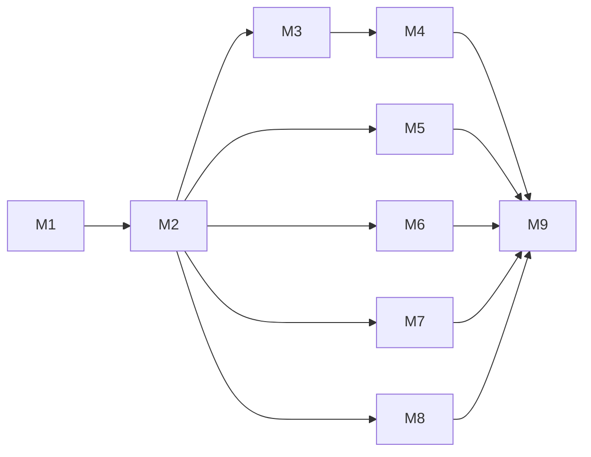

# Milestone Cafe Companion Pro

**Status:** Rencana kerja aktif
**Disusun:** 3 Oktober 2026

Folder ini memecah Release 1 menjadi milestone berurutan. Tiap milestone punya tujuan, kriteria selesai, dan task rinci per jalur kerja, supaya pekerjaan terarah dan tidak sekadar "lanjut ke hal berikutnya".

Milestone **tidak** menambah atau mengubah cakupan produk. Cakupan tetap diatur dokumen di [`../README.md`](../README.md) (PRD v2.3, `prd.md`, tier, paket, lalu dokumen foundation). Bila milestone bertentangan dengan dokumen itu, dokumen produk dan foundation yang berlaku, dan milestone diperbaiki.

---

## 1. Cara memakai

| Dokumen                        | Peran                                                                                      |
| ------------------------------ | ------------------------------------------------------------------------------------------ |
| `docs/milestones/*`            | Rencana: apa yang harus tercapai, dalam urutan apa, dan kapan dianggap selesai             |
| [`TODO.md`](../../TODO.md)     | Catatan checkpoint aktif: apa yang sedang dan sudah dikerjakan, beserta gate verifikasinya |
| [`AGENTS.md`](../../AGENTS.md) | Aturan kerja: satu checkpoint, verifikasi, commit, push                                    |

Alur kerja:

1. Ambil milestone yang berstatus **Berjalan**. Hanya satu milestone yang berjalan pada satu waktu, kecuali task yang ditandai boleh paralel.
2. Pilih task berikutnya yang ketergantungannya sudah selesai. Task besar dipecah menjadi beberapa checkpoint yang bisa di-push sendiri.
3. Catat checkpoint di `TODO.md`. Saat selesai, centang task di file milestone dan tulis hash commit-nya.
4. Milestone selesai bila semua kriteria selesai tercentang dan pengguna menyetujui hasil review.
5. Milestone berikutnya baru dimulai setelah itu, kecuali pengguna memutuskan lain.

---

## 2. Penamaan dan status

**ID task:** `M<nomor>-<jalur>-<urut>`, misalnya `M3-BE-02`.

**Jalur kerja:**

| Kode | Jalur                       | Isi                                                                            |
| ---- | --------------------------- | ------------------------------------------------------------------------------ |
| FT   | Fitur produk                | Capability yang dirasakan pengguna, sesuai tier Basic                          |
| BE   | Backend dan data            | Tabel, migrasi, use case, endpoint, event, worker                              |
| UX   | Alur dan interaksi          | Layar, navigasi, state kosong/error/izin, responsive, terang/gelap, dua bahasa |
| DS   | Design system dan komponen  | Token, komponen `packages/ui`, story, aksesibilitas komponen                   |
| AS   | Aset                        | Ikon aplikasi, logo, gambar, suara, template cetak, berkas unduhan             |
| SC   | Keamanan dan privasi        | Otorisasi, isolasi, idempotency, audit, data guard per surface                 |
| QA   | Kualitas kode dan test      | Struktur SOLID, batas modul, test unit/kontrak/integrasi/browser               |
| OP   | Operasional dan dokumentasi | Seed, runbook, CI, deploy, pembaruan dokumen foundation                        |

**Status task:** `[ ]` belum, `[~]` sedang dikerjakan, `[x]` selesai (dengan hash commit), `[-]` dibatalkan atau dipindah (dengan alasan).

**Status milestone:** Belum mulai · Berjalan · Menunggu review · Selesai.

---

## 3. Daftar milestone

| #   | Milestone                                                           | Tahap PRD | Tujuan                                                                                                           | Bergantung pada          | Status          |
| --- | ------------------------------------------------------------------- | --------- | ---------------------------------------------------------------------------------------------------------------- | ------------------------ | --------------- |
| M1  | [Fondasi UI dan POS inti](./M01-fondasi-ui-dan-pos-inti.md)         | A, C      | Backoffice Catalog dan POS-only menyelesaikan transaksi dari buka shift sampai tutup shift dengan UI baru        | —                        | Selesai         |
| M2  | [Core modular dan pengaturan](./M02-core-modular-dan-pengaturan.md) | B         | Paket berversi, instalasi modul, entitlement efektif, limit, event antarmodul, perangkat, dan halaman Pengaturan | M1                       | Selesai         |
| M3  | [Kitchen Display System](./M03-kds.md)                              | D         | KDS-only dan POS + KDS memakai use case yang sama                                                                | M2                       | Menunggu review |
| M4  | [Meja, Self-Order, dan Customer](./M04-meja-self-order-customer.md) | E         | Tata letak meja, sesi meja, QR, pesan dari meja, makan di tempat di POS, data pelanggan                          | M3                       | Selesai         |
| M5  | [Inventory](./M05-inventory.md)                                     | F         | Buku stok, opname, penerimaan, resep, konsumsi otomatis dari penjualan                                           | M2                       | Berjalan        |
| M6  | [Keuangan bisnis](./M06-keuangan-bisnis.md)                         | G         | Buku kas, pemasukan/pengeluaran, rekonsiliasi, penjualan tercatat otomatis tanpa pendapatan ganda                | M2                       | Belum mulai     |
| M7  | [Human Capital](./M07-human-capital.md)                             | H         | Karyawan, jadwal, absensi web, cuti; HC-only tanpa istilah F&B                                                   | M2                       | Belum mulai     |
| M8  | [Platform Admin dan laporan](./M08-platform-admin-dan-laporan.md)   | I         | Package Builder, kelola langganan dan override, akses support, laporan dasar per modul                           | M2 (laporan butuh M3–M7) | Belum mulai     |
| M9  | [Hardening, deploy, dan pilot](./M09-hardening-deploy-pilot.md)     | J, D-10   | Uji isolasi dan beban, aksesibilitas, backup, VPS Docker + Nginx, pilot 2–3 merchant                             | M1–M8                    | Belum mulai     |

M5, M6, dan M7 hanya bergantung pada M2, sehingga urutannya boleh ditukar bila prioritas bisnis berubah. Urutan di atas mengikuti `prd.md` bagian 11.2.

**Titik lanjut aktif:** pengguna menyatakan **“iya saya menerima lanjut ke m5”** setelah baseline `6129b5b`. M4 diterima; M5-BE-01A [fondasi satuan/jumlah](./M05-fondasi-satuan.md) selesai teknis/terverifikasi (10 domain/6 contracts baru, root gates/build API/web lulus; dipush sebagai `89ba34f`). M5-BE-01B1 [schema enam master/guard](./M05-master-inventory.md) juga selesai teknis/terverifikasi dan dipush sebagai `f3f7e5f`: 55 integrasi penuh, 5 static tests baru, root gates dan build API/web lulus; hanya PostgreSQL disposable, bukan migrasi development. B2a [query unit/conversion berizin](./M05-master-inventory.md#7-bukti-b2a) juga selesai teknis/terverifikasi dan dipush sebagai `8ccf52f`: 4 contracts + 11 source tests baru, 62 integrasi penuh/root gates/build lulus; belum runtime/manifest/HTTP. B2b1 [create unit transaksional](./M05-pembuatan-satuan.md) juga selesai teknis/terverifikasi dan dipush sebagai `fcc5c2f`: 12 source tests baru, 74 integrasi penuh/root gates/build API/web lulus; permission migration hanya disposable. NEXT B2b2 create direct conversion/parent/compatibility sebelum endpoint; parent B2b/B2/B/BE-01 belum selesai. Belum ada UI Inventory atau saldo aktif. OD-05 hanya menghalangi integrasi konsumsi nanti; PRD §15.4 tetap tiga titik potong. Review M2/M3 dan printer fisik tetap terpisah; GAP-02/03/04/07 tidak dihapus, dan tidak ada izin deploy/migrasi development/reslicing rute baru. Setiap checkpoint tetap verifikasi → commit → push sebelum lanjut.

**Riwayat sebelum penerimaan M4:** pengguna menginstruksikan `lanjut m4` setelah baseline `2a5f8fd`. M4 dilanjutkan dari GAP-01: [kontrak moderasi Basic](./M04-moderasi-basic.md), lalu checkpoint backend dan UI pada panel yang ada. M4-GAP01-BE dan UI/E2E kini tersedia, lulus gate lokal dan dipush sebagai `93f4931`; pengguna secara eksplisit melanjutkan UI sebelum BE dipush. GAP-01 selesai teknis. NEXT: review visual moderasi tetap terbuka; pengguna mengizinkan lanjut M4, setiap checkpoint berikutnya wajib verifikasi → commit → push; M4 belum diterima. GAP-05 gambar juga selesai teknis/terverifikasi lokal dan dipush sebagai `e287eb4`; GAP-06 struk selesai teknis end-to-end, review pengguna tetap terbuka: [GAP06A](./M04-struk-kunjungan.md#6-bukti-checkpoint-a) (`d86dd72`, dipush) mengoreksi alokasi struk per-order, sedangkan GAP06B-01 kontrak/proyeksi finansial murni sudah diverifikasi dan dipush sebagai `765d453`. GAP06B-02 query API lengkap/konsisten kini selesai teknis: 43 integrasi penuh, root gates dan build API/web lulus; dipush sebagai `86b3eef`. B-03 UI/cetak pada flow yang ada juga selesai teknis: 7 browser/34 capture, 2 smoke Storybook, regresi receipt/moderasi/gambar dan root gates/build lulus; dipush sebagai `53592d2`. NEXT: review pengguna dokumen kunjungan/FLOOR-005 dan gate visual M4, bukan M5 atau rute baru. Inventaris dan arah layout berjarak/tanpa fakta ganda ada di [kontrak B](./M04-struk-kunjungan.md#7-gap06b--checkpoint-dan-kontrak); endpoint snapshot dan UI/cetak tersedia, belum acceptance M4/printer fisik. Lihat [bukti gambar](./M04-gambar-menu-tamu.md). Koreksi KDS/M2 selesai teknis; review visual pengguna dan uji monitor M3 tetap terbuka. Pengecualian urutan ini tidak mengizinkan M5 atau reslicing/redesign rute baru.

**Riwayat sebelum instruksi lanjut M4:** pengguna menolak hasil visual M3 setelah penutupan teknis (`e7ac7e3`, `10799b9`) dan meminta koreksi KDS lalu audit ulang layout M2. M3-UX-05 **Berjalan**; review pengguna/uji monitor fisik tetap terbuka. M4 masih menunggu review. Lihat [review M3/M4 dan gap Release 1](./REVIEW-M03-M04.md). Moderasi staf Self-Order Basic adalah gap M4 dan tidak digabung dalam batch M3. Tidak memulai milestone berikutnya; audit ulang M2 diizinkan eksplisit oleh pengguna, bukan persetujuan otomatis terhadap hasil visual M3.

---

## 4. Definition of Done untuk setiap task

Task baru boleh dicentang bila semua yang relevan terpenuhi:

**Backend**

- Pemilik data dan modul jelas; tidak ada repository atau tabel modul lain yang ditulis langsung tanpa alasan tertulis.
- Use case satu kelas satu aksi; domain tanpa NestJS/Prisma; controller hanya parsing dan pemetaan.
- Kontrak Zod bersama untuk header, params, query, body, dan response.
- Setiap query membawa `tenant_id` (dan `outlet_id` bila berbatas lokasi); test substitusi ID lintas workspace.
- Mutasi kritis idempotent; audit dan outbox ditulis dalam transaksi yang sama.
- Error memakai kode stabil; teks untuk pengguna diterjemahkan di klien.
- Migrasi ditulis tangan dengan constraint, indeks, dan foreign key komposit tenant; test skema ditambah.

**UI**

- Inventaris field dibuat sebelum JSX (input pengguna, tampilan, turunan, disembunyikan).
- Judul tanpa deskripsi, satu aksi utama, satu fakta satu lokasi, tanpa kartu bersarang.
- Semua teks dari kamus `id` dan `en`; komponen `packages/ui` menerima label lewat props.
- State loading, kosong, error, izin, entitlement, setup, dan limit tersedia sesuai relevansi.
- Lolos di 320/390, 768, dan 1440 px; terang dan gelap; keyboard dan fokus.

**Verifikasi**

- `pnpm lint`, `pnpm typecheck`, `pnpm test`, `pnpm format:check`, dan pemeriksaan warna lulus.
- Endpoint baru diuji langsung terhadap API lokal; layar baru diuji di browser (Playwright) dengan database lokal.
- Dokumen foundation yang terdampak (`schema.md`, `backend.md`, `frontend.md`, `security.md`, `flowchart.md`, `design-system.md`) diperbarui dalam checkpoint yang sama.

---

## 5. Gerbang Release 1

Diambil dari `architecture.md` bagian 17. Masing-masing dipetakan ke milestone yang membuktikannya.

| Gerbang                                                                               | Dibuktikan di                   |
| ------------------------------------------------------------------------------------- | ------------------------------- |
| Dua workspace berjalan tanpa kebocoran data                                           | M1 (dasar), M9 (uji penuh)      |
| Provisioning paket dan modul tunggal idempotent                                       | M2, M8                          |
| Entitlement, izin, limit, dan instalasi menghasilkan alasan berbeda                   | M2                              |
| POS-only tidak error tanpa KDS, Finance, atau Inventory                               | M1, M2                          |
| POS + KDS + Inventory + Finance memproses event tanpa transaksi ganda                 | M3, M5, M6                      |
| HC-only onboard tanpa istilah F&B                                                     | M7                              |
| Finance-only mencatat transaksi tanpa referensi pesanan                               | M6                              |
| Floor: lantai/area bawaan, tiga bentuk meja, QR, sesi, pindah meja, tampilan langsung | M4                              |
| KDS menerima input manual tanpa POS                                                   | M3                              |
| Downgrade dan suspend tidak menghapus riwayat                                         | M2, M8                          |
| S/M/L, terang/gelap, `id`/`en`, aksesibilitas dasar pada surface R1                   | Setiap milestone, diaudit di M9 |
| Backup/restore, monitoring, migrasi, smoke test staging                               | M9                              |

---

## 6. Keputusan terbuka per milestone

| ID       | Pertanyaan                                                                                                                                                                              | Harus diputuskan sebelum       |
| -------- | --------------------------------------------------------------------------------------------------------------------------------------------------------------------------------------- | ------------------------------ |
| M1-OD-01 | **Diputuskan 3 Oktober 2026:** di M1 harga menu adalah harga akhir (sudah termasuk pajak), total = subtotal. Pola "ditambahkan di struk" dan tarif per outlet dikerjakan di `M2-FT-09`. | —                              |
| OD-04    | **Diputuskan 16 Oktober 2026:** KDS-only memakai input manual **dan** API intake (sumber intake dengan kunci per sistem luar; M3-BE-08, M3-SC-03).                                      | —                              |
| OD-05    | Titik potong stok bawaan per template                                                                                                                                                   | M5                             |
| OD-06    | Pengakuan pendapatan saat penjualan selesai atau saat pembayaran dikonfirmasi                                                                                                           | M6                             |
| OD-02    | HC Basic dijual di R1 atau beta sesudahnya                                                                                                                                              | M7                             |
| OD-08    | Masa simpan audit, bukti absensi, data pelanggan, lampiran                                                                                                                              | M9                             |
| OD-01    | Nama produk final                                                                                                                                                                       | M9 (sebelum peluncuran publik) |
| OD-12    | Harga paket dan add-on                                                                                                                                                                  | Setelah pilot M9               |
